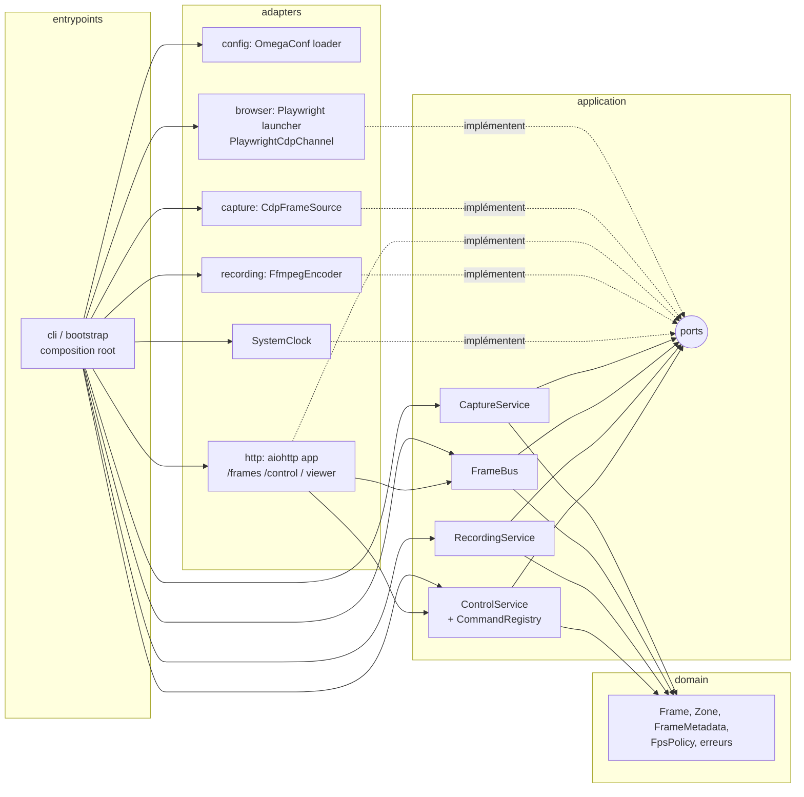
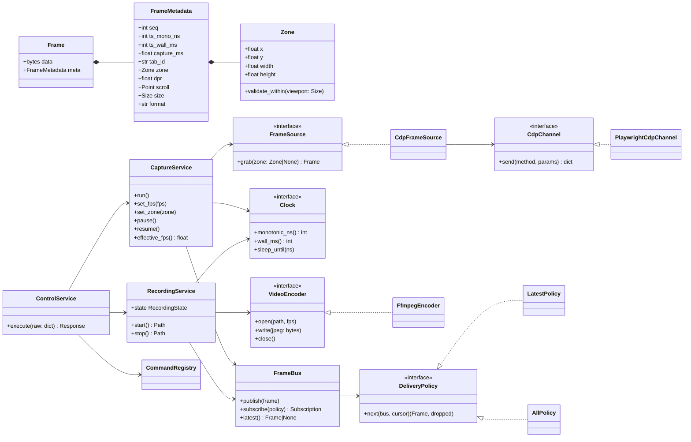
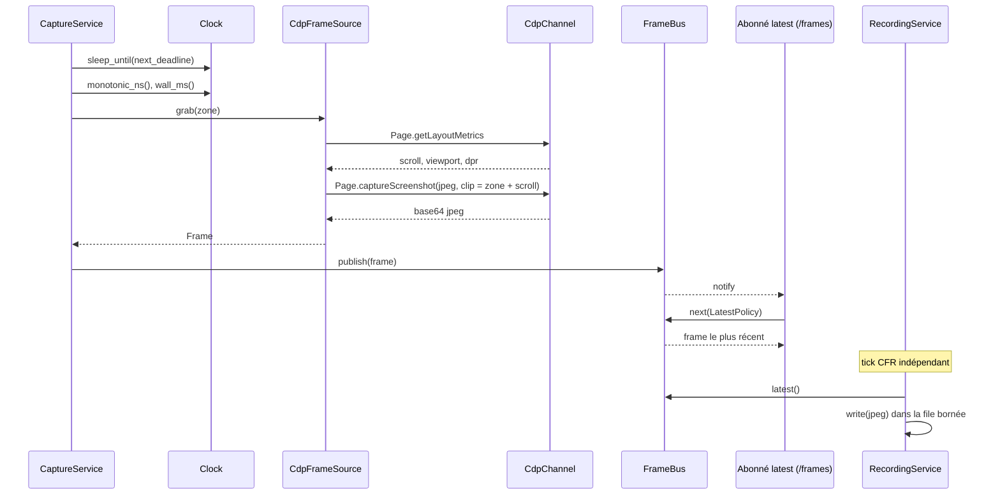
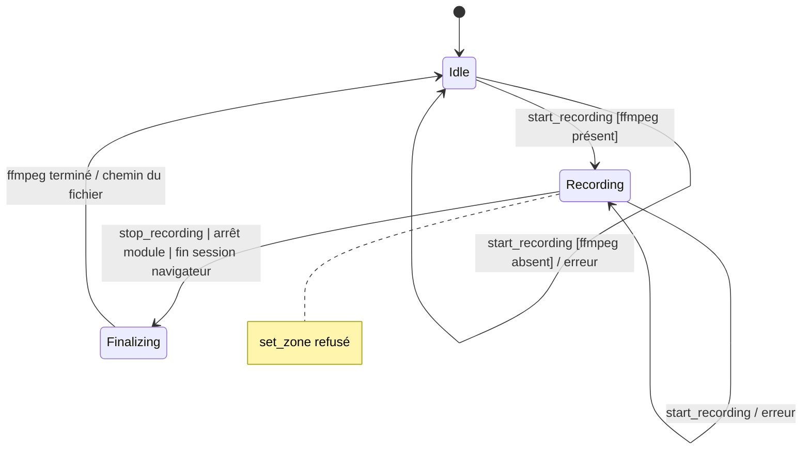
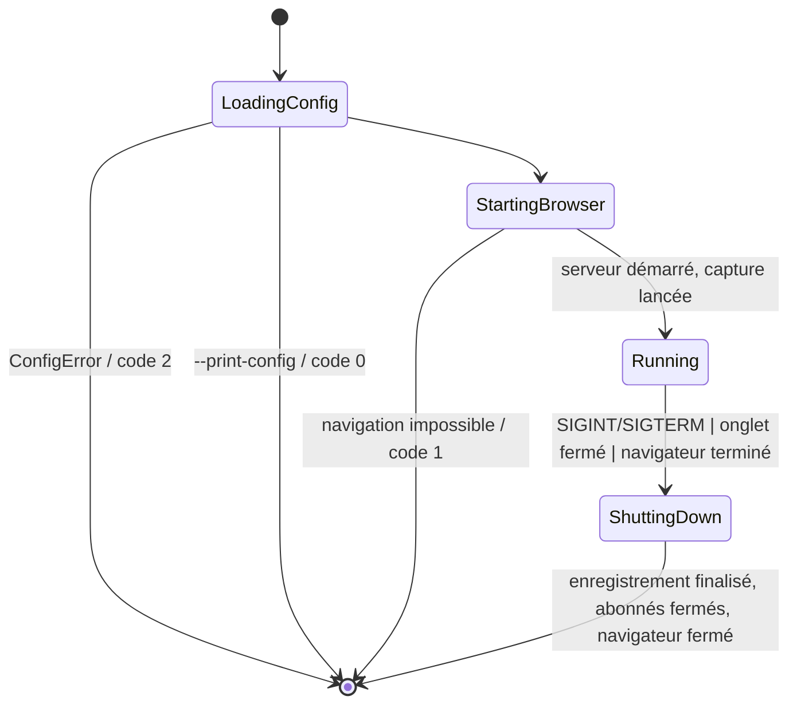

# Design

## Context

Projet vierge : aucun code existant, seul OpenSpec est initialisé. Motivation et périmètre : voir proposal.md. Exigences : voir `specs/`.

Contraintes issues de l'exploration :
- Phase 1 : le module lance son propre Chromium. Phase 2 (hors change) : rattachement à un onglet du navigateur de l'utilisateur, très probablement via une extension utilisant `chrome.debugger` (depuis Chrome 136, `--remote-debugging-port` est ignoré sur le profil par défaut, ce qui ferme la voie de l'attachement CDP direct).
- Le module d'analyse est un processus séparé sur la même machine ; il ne doit dépendre que du protocole réseau.
- Un change ultérieur ajoutera des actions sur la page (click, saisie, scroll) à partir de coordonnées exprimées dans l'image.

## Goals / Non-Goals

**Goals:**
- Que la phase 2 n'ait qu'à remplacer le transport CDP, sans toucher à la capture, à la distribution ni au protocole.
- Que le futur change d'actions puisse convertir des coordonnées image en coordonnées page à partir du seul en-tête d'image.
- Qu'aucun consommateur (viewer, analyse, enregistrement) ne puisse ralentir la capture.
- Que le domaine et les services applicatifs soient testables sans navigateur, sans réseau et sans ffmpeg (D13).

**Non-Goals:**
- Performances au-delà de 30 FPS (la source screencast viendra plus tard).
- Authentification des clients : on se limite à l'écoute locale et au contrôle d'origine.
- Persistance du buffer circulaire sur disque.

## Decisions

### D1. Python 3.11+ et asyncio, un seul processus
Toute la logique (capture, distribution, serveur, enregistrement) tourne dans une seule boucle asyncio. Les E/S dominent (CDP, WebSocket, pipe ffmpeg) ; aucun traitement d'image n'est fait dans le module, donc le GIL n'est pas un problème.
*Alternatives* : Node.js (Playwright natif, mais l'écosystème d'analyse d'image visé est Python) ; plusieurs processus (complexité inutile en phase 1).

### D2. Playwright pour lancer le navigateur, CDP brut pour capturer
Playwright (`chromium.launch`) gère le téléchargement, le lancement et le cycle de vie de Chromium. Toutes les opérations de capture passent par une session CDP (`page.context.new_cdp_session(page)`), encapsulée derrière une interface minimale :

```
CdpChannel.send(method: str, params: dict) -> dict
```

La phase 2 fournira une autre implémentation de `CdpChannel` (relais WebSocket vers l'extension → `chrome.debugger.sendCommand`), qui parle le même vocabulaire CDP.
*Alternative* : `page.screenshot()` de Playwright, plus simple mais spécifique à Playwright et donc à réécrire en phase 2.

### D3. Capture par polling de `Page.captureScreenshot`
À chaque échéance :
1. `ts_mono_ns` / `ts_wall_ms` sont relevés.
2. `Page.getLayoutMetrics` fournit le scroll (`cssVisualViewport.pageX/pageY`), la taille du viewport en CSS et le DPR (`visualViewport.clientWidth / cssVisualViewport.clientWidth`). On évite `Runtime.evaluate`, qui peut être bloqué par le JavaScript de la page.
3. `Page.captureScreenshot` avec `format: "jpeg"`, `quality` (80 par défaut), `captureBeyondViewport: false` et, si une zone est définie, `clip = {x: zone.x + pageX, y: zone.y + pageY, width, height, scale: 1}`. Le décalage du scroll garde la zone fixe par rapport au viewport.
4. Le `Frame` est construit et publié dans le buffer.

Le polling donne un contrôle exact du FPS et un clip natif.
*Alternative* : `Page.startScreencast` (push, plus rapide mais FPS non maîtrisé et aucune image sur une page statique), à ajouter plus tard comme second `FrameSource`.

### D4. Ordonnanceur à échéances absolues sans rattrapage
La boucle calcule `next = last_deadline + 1/fps`. Si `now > next`, on recale `next` sur la prochaine échéance future (les échéances manquées sont sautées). Un changement de FPS prend effet en recalculant l'échéance suivante à partir de maintenant. Le FPS effectif est calculé sur une fenêtre glissante d'une seconde. Pause/reprise attendent sur un `asyncio.Event`.

### D5. Modèle de données `Frame`
```
Frame:
  seq: int                     # 0.., strictement croissant
  ts_mono_ns: int              # time.monotonic_ns() au déclenchement
  ts_wall_ms: int              # time.time_ns() // 1e6 au déclenchement
  capture_ms: float
  tab_id: str                  # targetId CDP
  zone: {x, y, width, height}  # px CSS relatifs au viewport (viewport complet si pas de zone)
  dpr: float
  scroll: {x, y}               # px CSS
  size: {width, height}        # px image
  format: "jpeg"
  data: bytes
```
Conversion future d'un point image `(u, v)` vers le viewport : `(zone.x + u/dpr, zone.y + v/dpr)`. `zone` est toujours renseignée, même sans zone définie, pour rendre ce calcul uniforme.

### D6. Buffer circulaire et abonnements (`FrameBus`)
`FrameBus` : `collections.deque(maxlen=N)` + dernier `seq` + `asyncio.Condition` notifiée à chaque publication. Le producteur ne bloque jamais.

- **latest** : chaque abonné a une tâche d'envoi qui attend une notification, prend l'image la plus récente si son `seq` est supérieur au dernier envoyé, l'envoie (`await ws.send_bytes`) puis recommence. Pendant un envoi lent, les publications ne s'accumulent pas : seule la plus récente sera prise ensuite.
- **all** : un curseur `next_seq` par abonné. Si `next_seq < oldest_seq`, `dropped = oldest_seq - next_seq` et le curseur saute à `oldest_seq`.

L'isolation repose sur le fait que chaque abonné a sa propre tâche ; un envoi bloqué ne bloque que cette tâche. Un délai d'envoi (par exemple 10 s) ferme les abonnés morts.

### D7. Serveur : aiohttp sur un seul port
aiohttp sert `/` (viewer statique), `/frames` et `/control` (WebSocket) sur le même port (8765 par défaut, hôte 127.0.0.1 par défaut). Un seul port simplifie le contrôle d'origine du viewer (même origine).
*Alternative* : la bibliothèque `websockets` plus un serveur de fichiers statiques séparé (deux ports, Origin plus compliqué).

Contrôle d'origine : si l'en-tête `Origin` est présent et diffère de `http://<host>:<port>` (avec équivalence `127.0.0.1`/`localhost`), la poignée de main est refusée avec un 403. Cela protège contre le cross-site WebSocket hijacking par une page web ouverte ailleurs sur la machine.

### D8. Protocole de message d'image
`[uint32 BE longueur_en_tête][en-tête JSON UTF-8][JPEG]`. On choisit un message binaire unique plutôt qu'un JSON suivi d'un binaire en deux messages : pas de risque de désynchronisation et décodage trivial dans n'importe quel langage. Le champ `dropped` vaut toujours 0 en mode latest.

### D9. Enregistrement MP4 par rééchantillonnage à cadence constante
Le recorder est un consommateur interne (pas un abonné WebSocket) avec son propre ordonnanceur au FPS figé au démarrage. À chaque pas, il prend la dernière image du buffer et écrit ses octets JPEG dans le stdin de :

```
ffmpeg -loglevel error -f image2pipe -c:v mjpeg -framerate <F> -i - \
       -vf "scale=trunc(iw/2)*2:trunc(ih/2)*2" -c:v libx264 -pix_fmt yuv420p \
       -movflags +faststart <out>.mp4
```

La duplication ou le saut d'images découle directement de cet échantillonnage. L'écriture passe par une file bornée (par exemple 2 s d'images) consommée par une tâche d'écriture ; si la file est pleine, l'image est perdue et comptée. La finalisation ferme stdin puis attend la sortie de ffmpeg. Le filtre `scale` est nécessaire parce que H.264 en yuv420p exige des dimensions paires. La zone ne peut pas changer pendant l'enregistrement (spec), donc la taille reste stable.
*Alternatives* : PyAV (dépendance binaire lourde) ; VFR avec horodatages réels (moins compatible avec les lecteurs, rejeté pendant l'exploration).

Le binaire ffmpeg est résolu au démarrage de l'enregistrement : d'abord `shutil.which("ffmpeg")`, puis, en repli, le binaire statique fourni par la dépendance pip `imageio-ffmpeg` (`imageio_ffmpeg.get_ffmpeg_exe()`). Si aucun des deux n'est disponible, l'erreur `EncoderUnavailableError` est levée. Le nom de fichier est généré côté serveur (`capture-YYYYMMDD-HHMMSS.mp4`) dans le répertoire de sortie, qui est créé si besoin. Aucun chemin ne vient du client.

### D10. Viewer en HTML/JS natif
Un seul fichier statique, sans build. Il ouvre `/frames` (latest) avec `binaryType = "arraybuffer"`, découpe l'en-tête, passe le JPEG à `createImageBitmap(new Blob([...]))` puis le dessine sur un `<canvas>`. Comme module et viewer partagent la même horloge, la latence affichée vaut `Date.now() - ts_wall_ms`. Les contrôles envoient des commandes sur `/control`, et la reconnexion utilise un backoff simple (1 s, puis jusqu'à 5 s).

### D11. Configuration avec OmegaConf (structured config)
Le schéma est un ensemble de dataclasses typées, qui sert de source unique pour les valeurs par défaut et les types :

```
AppConfig
  browser:   BrowserConfig   (url: str = MISSING, headless: bool = False, viewport: ViewportConfig(1280, 720))
  capture:   CaptureConfig   (fps: float = 10, zone: ZoneConfig | None = None, jpeg_quality: int = 80)
  streaming: StreamingConfig (buffer_size: int = 60, send_timeout_s: float = 10)
  server:    ServerConfig    (host: str = "127.0.0.1", port: int = 8765)
  recording: RecordingConfig (output_dir: str = "./recordings")
  logging:   LoggingConfig   (level: str = "INFO")
```

Chargement :
`OmegaConf.structured(AppConfig)` → `merge(fichier YAML si --config)` → `merge(OmegaConf.from_dotlist(surcharges))` → `OmegaConf.to_object()` → `validate(AppConfig)`.

- Le mode structured rejette les clés inconnues et les types invalides à la fusion, et `MISSING` signale `browser.url` absent. Les erreurs OmegaConf (`ConfigKeyError`, `ValidationError`, `MissingMandatoryValue`) sont converties en `ConfigError` avec le chemin de la clé.
- Les règles métier (bornes du FPS, zone contenue dans le viewport, qualité JPEG entre 1 et 100) sont vérifiées par une fonction `validate()` explicite qui réutilise les validations du domaine. Ces règles ne sont donc écrites qu'une fois, puisque le canal de contrôle applique les mêmes.
- Le reste de l'application reçoit des dataclasses figées (`frozen=True`) et ne dépend jamais d'OmegaConf, qui reste confiné à l'adapter de configuration.
- CLI : `web-capture [--config FILE] [--print-config] [clé=valeur ...]`. `argparse` ne lit que les deux options ; les autres arguments forment la dotlist.
- `configs/default.yaml` est versionné à titre d'exemple documenté. Il n'est pas obligatoire, puisque les valeurs par défaut sont dans les dataclasses.
- Si `server.host` n'est pas une adresse de boucle locale, un avertissement est journalisé.

*Alternative* : Hydra (bâti sur OmegaConf), écartée car ses répertoires de sortie, son changement de répertoire de travail et ses multiruns n'apportent rien à un service longue durée. pydantic-settings a aussi été écarté, OmegaConf étant le choix demandé.

### D12. Packaging et outillage : Poetry
- `pyproject.toml` au format PEP 621 (`[project]`) avec le backend `poetry-core>=2`, `poetry.lock` versionné et un layout `src/` qui empêche d'importer le paquet depuis la racine sans installation.
- Dépendances d'exécution : `playwright`, `aiohttp`, `omegaconf`, `imageio-ffmpeg`.
- Groupe `dev` : `pytest`, `pytest-asyncio`, `pytest-cov`, `ruff`, `mypy`.
- Script `web-capture = "web_capture.entrypoints.cli:main"`.
- **Environnement virtuel dans le projet** : un fichier `poetry.toml` versionné contient `[virtualenvs] in-project = true`, si bien que `poetry install` crée `.venv/` à la racine du dépôt, quelle que soit la configuration globale de Poetry. VS Code détecte automatiquement `.venv/` comme interpréteur. `.venv/` est ignoré par `.gitignore`, avec les caches (`__pycache__/`, `.pytest_cache/`, `.mypy_cache/`, `.ruff_cache/`) et `recordings/`.
  *Alternative* : le cache global de Poetry (`~/.cache/pypoetry/virtualenvs`), écarté parce que l'environnement serait moins visible et moins facile à supprimer ou à recréer avec le projet.
- Ruff assure le lint et le formatage ; mypy est en mode `strict` sur `src/`. pytest utilise les marqueurs `integration` (Chromium réel) et `ffmpeg` (encodage réel ; la vérification des vidéos utilise `imageio_ffmpeg.count_frames_and_secs`, donc pas besoin de ffprobe), ce qui permet de lancer `poetry run pytest -m "not integration"` en boucle rapide.

### D13. Architecture hexagonale (ports & adapters)
Les règles de dépendance vont uniquement vers l'intérieur : `entrypoints → adapters → application → domain`. Le domaine ne fait aucune E/S et n'importe aucune bibliothèque tierce. L'application ne connaît que des **ports** (`typing.Protocol`).



Organisation :
```
pyproject.toml  poetry.lock  configs/default.yaml
src/web_capture/
  domain/
    frame.py           # Frame, FrameMetadata, Zone, Size, Point (dataclasses figées)
    rules.py           # validation FPS / zone / qualité, FpsPolicy
    errors.py          # WebCaptureError > InvalidFpsError, InvalidZoneError, RecordingError...
  application/
    ports.py           # CdpChannel, FrameSource, Clock, VideoEncoder, BrowserSession
    capture_service.py # ordonnanceur (D4), pause/reprise, réglages à chaud
    frame_bus.py       # buffer circulaire + abonnements (D6)
    delivery.py        # LatestPolicy, AllPolicy
    recording_service.py
    control/
      commands.py      # SetFps, SetZone, Pause, Resume, StartRecording, StopRecording, GetStatus
      registry.py      # CommandRegistry : nom -> (parseur, handler)
      service.py       # ControlService.execute(raw) -> Response
  adapters/
    config/omegaconf_loader.py  config/schema.py
    browser/playwright_session.py  browser/playwright_cdp.py
    capture/cdp_frame_source.py
    recording/ffmpeg_encoder.py
    http/app.py  http/frames_ws.py  http/control_ws.py  http/origin.py  http/codec.py
    http/static/viewer.html
    clock.py
  entrypoints/
    cli.py             # argparse minimal, --print-config, codes de sortie
    bootstrap.py       # composition root : construit et relie tous les objets, gère le cycle de vie
tests/
  unit/  (domain, application avec faux ports)    integration/  (Chromium, aiohttp, ffmpeg)
  fakes/ (FakeClock, FakeFrameSource, FakeEncoder)  assets/grid.html
```

Le codec binaire de `/frames` (D8) appartient à l'adapter HTTP : c'est un format de transport, pas un concept métier.

### D14. Design patterns retenus (et pourquoi)
Seuls les patterns qui répondent à un besoin identifié pendant l'exploration sont retenus :

| Pattern | Où | Besoin couvert |
|---|---|---|
| **Ports & Adapters** | `application/ports.py` | Remplacer Playwright par le relais d'extension en phase 2 ; tester l'application sans navigateur |
| **Adapter** | `PlaywrightCdpChannel`, plus tard `ExtensionCdpChannel` | Exposer deux transports sous un même `CdpChannel.send()` |
| **Strategy** | `DeliveryPolicy` (`LatestPolicy`, `AllPolicy`) | Les modes latest et all sans branchement dans le bus ; d'autres politiques possibles plus tard |
| **Publish/Subscribe (Observer)** | `FrameBus` | Un producteur, N consommateurs indépendants et non bloquants |
| **Command + Registry** | `application/control/` | Commandes `/control` typées, validées et extensibles. Le change « actions » ajoutera `Click`, `Type` et d'autres sans toucher au service |
| **State machine explicite** | `RecordingService` (enum + table de transitions) | Garantir l'enregistrement unique, le refus de `set_zone` et la finalisation sur tous les chemins |
| **Composition Root / injection par constructeur** | `entrypoints/bootstrap.py` | Un seul endroit construit le graphe d'objets ; pas de singleton ni de framework d'injection |

Patterns écartés : un framework d'injection de dépendances (inutile pour une dizaine d'objets) et le pattern State en classes (une enum avec une table de transitions suffit pour 3 états).

### D15. Modèles UML

**Diagramme de classes (cœur applicatif et ports)**



**Séquence : un tick de capture puis la diffusion**



**États de l'enregistrement**



**Cycle de vie du module (composition root)**



L'arrêt se fait dans l'ordre inverse de la construction. Il est piloté par `bootstrap.py` via un `asyncio.TaskGroup` et un événement d'arrêt unique alimenté par les signaux et par la session navigateur.

### D16. Stratégie de tests
- **Unitaires** (sans E/S) : domaine (zone, règles), `FrameBus` et les politiques, l'ordonnanceur avec `FakeClock` et `FakeFrameSource`, `ControlService` et le registre de commandes, la machine à états de `RecordingService` avec `FakeEncoder`, le chargeur de configuration (priorités, clé inconnue, `MISSING`, bornes), le codec et le contrôle d'origine.
- **Intégration** (`-m integration`) : `CdpFrameSource` sur Chromium headless et `grid.html` (zone, scroll, DPR), serveur aiohttp (`/frames`, `/control`, Origin), `FfmpegEncoder` avec contrôle par `count_frames_and_secs`, viewer piloté par Playwright, cycle de vie de bout en bout (SIGINT, fermeture de l'onglet).

## Risks / Trade-offs

- [Le décalage `clip` + scroll de D3 dépend du comportement de Chromium selon les versions] → test d'intégration dédié qui fait défiler la page et vérifie la couleur d'un repère fixe dans la zone.
- [Le polling plafonne entre 10 et 20 FPS en 1080p selon la machine] → le FPS effectif est exposé, la limite est documentée et une source screencast est prévue plus tard.
- [Une page très chargée retarde la réponse de `captureScreenshot`] → aucun rattrapage (D4) et `capture_ms` exposé par image pour le diagnostic.
- [En mode visible, une fenêtre minimisée ou masquée peut cesser d'être rendue] → documenter ce point et recommander `--headless` pour une capture sans surveillance.
- [Aucune authentification : tout processus local peut lire le flux et piloter la capture] → acceptable pour une utilisation locale en phase 1, avec écoute locale par défaut, contrôle d'origine et avertissement si l'hôte n'est pas local.
- [Les images JPEG en mémoire : 60 × environ 200 Ko ≈ 12 Mo] → négligeable ; la taille du buffer reste configurable.
- [ffmpeg n'est pas toujours installé sur la machine] → repli sur le binaire statique d'`imageio-ffmpeg` (environ 30 Mo par plateforme), le ffmpeg système restant prioritaire ; erreur explicite si aucun n'est disponible (spec).

## Open Questions

- Qualité JPEG par défaut (80) et taille par défaut du buffer (60) : à ajuster après des mesures sur des pages réelles, sans impact sur les specs.
